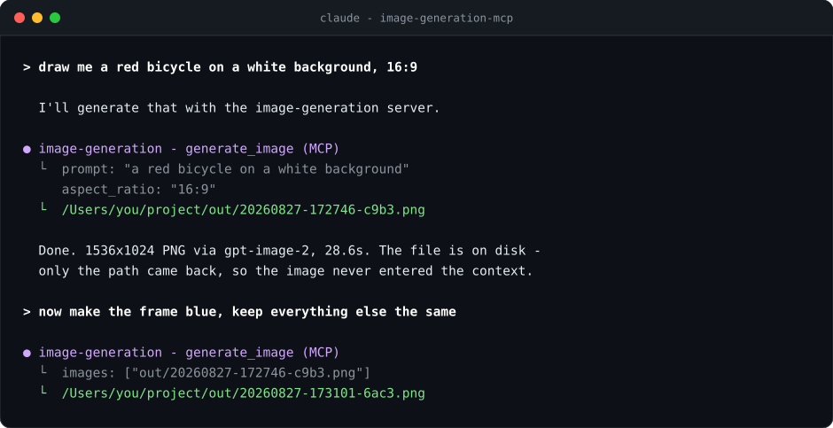
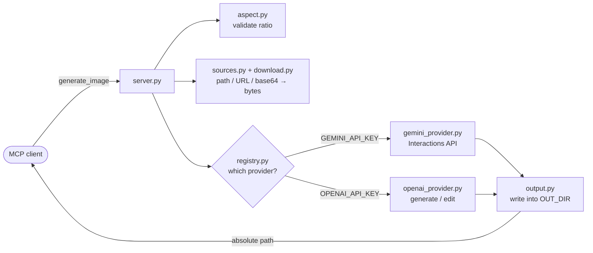

<p align="center">
  
</p>

<h1 align="center">image-generation-mcp</h1>

<p align="center">
  <strong>Give any MCP-capable agent the ability to draw.</strong><br>
  One tool, two providers, zero image bytes in your context window.
</p>

<p align="center">
  <a href="https://modelcontextprotocol.io"></a>
  <a href="https://www.python.org/downloads/"></a>
  <a href="#providers"></a>
  <a href="https://github.com/astral-sh/ruff"></a>
  <a href="https://mypy-lang.org/"></a>
  <a href="#development"></a>
  <a href="LICENSE"></a>
</p>

---

Ask your agent for a picture, and it gets back a file path — not a wall of base64.
The server generates the image with **Gemini** or **OpenAI**, writes it to disk, and
returns only the absolute path. Your context window stays clean, and the file is
right there for the agent to open, move, or hand to another tool.

<p align="center">
  
</p>

## Features

- **One tool, no ceremony.** `generate_image(prompt, images, aspect_ratio)` — that's the whole API.
- **Paths, not payloads.** Returns an absolute file path, so a 1.5 MB PNG costs you ~60 tokens instead of ~2 million.
- **Two providers, auto-selected.** Set whichever API key you have. Both set? `IMAGE_PROVIDER` decides.
- **Image-to-image.** Pass up to 4 reference images to restyle, edit, or combine them.
- **Flexible inputs.** A reference can be a local path, an `http(s)` URL, a `data:` URI, or bare base64 — the server figures out which.
- **Both transports.** stdio for local clients, streamable HTTP (localhost-bound) when you need a port.
- **Honest errors.** No retries that mask a bad key, no silent provider fallback. When the API says 429, you see 429.
- **Small enough to read.** ~540 lines of source, no file over 100 lines, strict-typed throughout.

## Prerequisites

| Requirement | Notes |
| --- | --- |
| **Python 3.11+** | 3.12 is what CI-equivalent local checks run on |
| **[uv](https://docs.astral.sh/uv/)** | `curl -LsSf https://astral.sh/uv/install.sh \| sh` |
| **An API key** | Google Gemini **or** OpenAI — at least one |

> **Billing note.** Image models are not free tier on either provider. A Gemini key
> without billing enabled returns `429 ... limit: 0` for every image model.

## Quick Start

```bash
git clone https://github.com/farukcan/image-generation-mcp.git
cd image-generation-mcp
uv sync

cp .env.example .env      # add OPENAI_API_KEY or GEMINI_API_KEY
uv run pytest -m smoke    # generates a real image into out/
```

That last command is the fastest way to confirm your key works end to end — it
prints the path of the image it just made.

## Add it to your agent

### Claude Code

```bash
claude mcp add image-generation \
  -e OPENAI_API_KEY=sk-... \
  -- uvx --from git+https://github.com/farukcan/image-generation-mcp image-generation-mcp
```

`uvx` fetches, builds, and caches the package on first run — there is nothing to
install beforehand and nothing to keep updated by hand.

Prefer a checkout you can edit? Point it at the directory instead:

```bash
claude mcp add image-generation \
  -e OPENAI_API_KEY=sk-... \
  -- uv run --directory /absolute/path/to/image-generation-mcp image-generation-mcp
```

Add `-s user` to make it available in every project instead of just this one.
Verify with `claude mcp list`, and remove it with `claude mcp remove image-generation`.

### Gemini CLI

Same flags, same shape:

```bash
gemini mcp add image-generation \
  -e OPENAI_API_KEY=sk-... \
  -- uvx --from git+https://github.com/farukcan/image-generation-mcp image-generation-mcp
```

### Cursor, Windsurf, Claude Desktop, and everything else

These read a JSON config file (`.cursor/mcp.json`, `claude_desktop_config.json`, …).
The entry is the same everywhere:

```json
{
  "mcpServers": {
    "image-generation": {
      "command": "uvx",
      "args": [
        "--from", "git+https://github.com/farukcan/image-generation-mcp",
        "image-generation-mcp"
      ],
      "env": {
        "OPENAI_API_KEY": "sk-...",
        "OUT_DIR": "/absolute/path/where/images/should/land"
      }
    }
  }
}
```

Set `OUT_DIR` explicitly for GUI clients — they often launch with a working
directory you did not expect, and `out/` would land there.

### As an HTTP service

```bash
uv run image-generation-mcp --transport http --port 8000
```

Serves the streamable-HTTP endpoint at `http://127.0.0.1:8000/mcp`. It binds to
loopback only and has no authentication, so put it behind a proxy before exposing it.

## The tool

```python
generate_image(
    prompt: str,
    images: list[str] | None = None,
    aspect_ratio: str = "1:1",
    parent: str | None = None,
    intent: str | None = None,
) -> str
```

| Parameter | Description |
| --- | --- |
| `prompt` | What the image should show. |
| `images` | Up to 4 reference images. Each is a local file path, an `http(s)://` URL (30 s timeout, streamed and aborted past 20 MB), a `data:` URI, or bare base64. An existing file always wins; otherwise a base64-shaped string is decoded as such. |
| `aspect_ratio` | `1:1`, `2:3`, `3:2`, `3:4`, `4:3`, `4:5`, `5:4`, `9:16`, `16:9`, `21:9`. |
| `parent` | The image being edited, if this is an edit. Same formats as `images`; sent to the model first and counts toward the 4-image limit. |
| `intent` | One sentence on what the image is for, e.g. `"top-down tile, transparent background, readable at 64px"`. |

Returns the absolute path of the written file, e.g. `/path/to/out/20260827-172746-c9b3.png`.
Names are `YYYYmmdd-HHMMSS-xxxx`, so results sort chronologically and never collide.

Next to every image a sidecar `<same name>.json` records how it was made:

```json
{
  "image": "20260827-172746-c9b3.png",
  "date": "2026-08-27T17:27:46+02:00",
  "intent": "top-down tile, transparent background, readable at 64px",
  "prompt": "...",
  "references": ["/abs/path/ref.png", "https://example.com/ref.jpg"],
  "parent": "/abs/path/20260827-170102-a1b2.png",
  "provider": "gemini",
  "model": "gemini-3.1-flash-image",
  "aspect_ratio": "1:1"
}
```

Local paths are stored absolute; base64 inputs are recorded as a placeholder, not inlined.
If you rename an image, rename its `.json` too and update its `image` field.

**On aspect ratios:** Gemini honours all ten. OpenAI accepts only three sizes, so
ratios collapse to the nearest of `1024x1024`, `1536x1024`, or `1024x1536` — asking
for `16:9` there gets you 3:2.

## Configuration

Every setting is an environment variable. A `.env` file in the working directory (or
any parent) is loaded as a fallback; real environment variables always win.

| Variable | Default | Purpose |
| --- | --- | --- |
| `GEMINI_API_KEY` | — | Enables the Gemini provider |
| `OPENAI_API_KEY` | — | Enables the OpenAI provider |
| `IMAGE_PROVIDER` | unset | Force `gemini` or `openai`. Unset means Gemini first, then OpenAI |
| `GEMINI_IMAGE_MODEL` | `gemini-3.1-flash-image` | Also `gemini-3-pro-image`, `gemini-3.1-flash-lite-image` |
| `OPENAI_IMAGE_MODEL` | `gpt-image-2` | Also `gpt-image-1.5`, `gpt-image-1`, `gpt-image-1-mini` |
| `OUT_DIR` | `<cwd>/out` | Where generated images are written |
| `MCP_TRANSPORT` | `stdio` | `stdio` or `http`; `--transport` overrides it |
| `MCP_PORT` | `8000` | HTTP port; `--port` overrides it |

Start the server with no API key at all and the first request fails loudly, naming
the variables it looked for.

## How it works



Each module does one thing and stays under 100 lines. Providers are cached per
resolved config, so an SDK client and its connection pool are reused across calls
rather than rebuilt every request.

## Providers

| | Gemini | OpenAI |
| --- | --- | --- |
| API | Interactions (`client.aio.interactions.create`) | Images (`images.generate` / `images.edit`) |
| SDK floor | `google-genai >= 2.3.0` | `openai >= 3.0.0` |
| Reference images | Sent inline as base64 parts | Uploaded as multipart files |
| Output format | Whatever the model returns — the extension follows it | Always PNG (`output_format="png"`) |

Two deliberate quirks worth knowing:

- Gemini's image `response_format` only accepts `image/jpeg` as an explicit MIME
  type, so the server does not request one and names the file after whatever comes back.
- `input_fidelity` is never sent to OpenAI — `gpt-image-2` rejects it with a 400 and
  applies high fidelity on its own.

## Development

```bash
uv run ruff check . && uv run ruff format --check .
uv run mypy
uv run pytest              # unit tests, all providers mocked
uv run pytest -m smoke -s  # real API calls; costs money, prints the paths
```

Smoke tests are deselected by default so a normal `pytest` run never spends money.
`test_edits_a_real_image` costs two generations, since it makes its own reference image.

The logo and the screenshot are generated too — edit the scripts, not the SVGs:

```bash
uv run python media/generate_logo.py
uv run python media/generate_screenshot.py
```

The 100-line-per-file ceiling is a design constraint, not an accident: it keeps every
module reviewable in one screen. Split rather than stretch.

## Troubleshooting

| Symptom | Cause |
| --- | --- |
| `429 ... limit: 0` | The model is not on your plan's free tier. Enable billing on the provider project. |
| `RuntimeError: No API key configured` | Neither key is set, and no `.env` was found from the working directory upward. |
| Images appear somewhere unexpected | `OUT_DIR` is unset and the client launched the server from a different directory. Set it explicitly. |
| `Unsupported aspect_ratio` | Only the ten listed ratios are accepted; the error lists them. |
| `reference images must be one of ...` | OpenAI takes PNG, JPEG, or WebP references only. |

## License

[MIT](LICENSE) © Ömer Faruk Can
